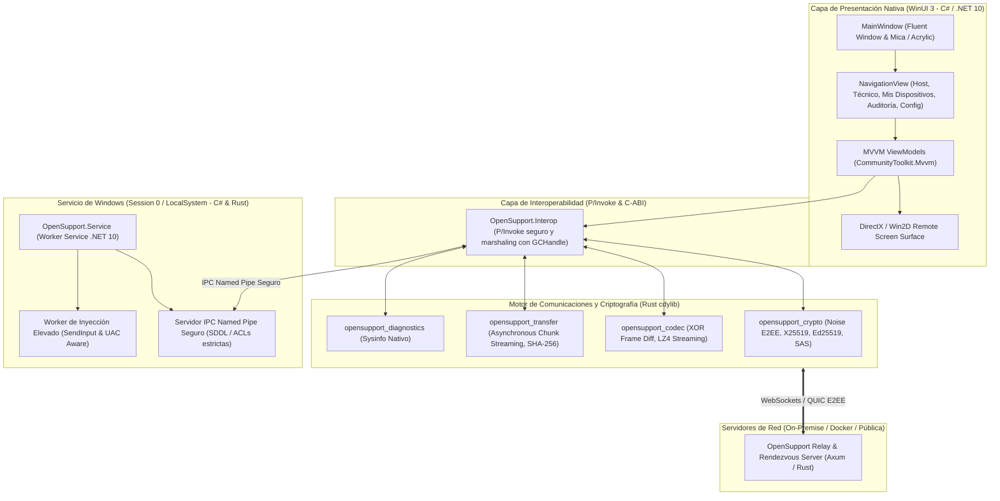

# ARQUITECTURA TÉCNICA DE LA APLICACIÓN NATIVA WINDOWS

> **Estándar:** .NET 10 LTS + WinUI 3 (Windows App SDK) + Rust FFI Engine + Windows Services  
> **Patrón Arquitectónico:** Clean Architecture + MVVM + Microservicios Locales IPC  

---

## 1. Diagrama de Capas del Sistema Nativo

---

## 2. Especificación de Componentes

### A. Aplicación de Escritorio WinUI 3 (`OpenSupport.App`)
- Desarrollada en C# y .NET 10 con soporte nativo de **Windows App SDK**.
- **Sin navegadores, sin WebView2 embebido como UI, sin HTML/CSS.**
- Controles 100% nativos: `NavigationView`, `ContentDialog`, `InfoBar`, `DataGrid`, `NumberBox`.
- Compatibilidad con diseño Fluent: Efectos de material *Mica*, bordes redondeados y alternancia dinámica de temas claro/oscuro.

### B. Puente FFI Nativo (`opensupport-ffi`)
- Crate en Rust configurado como `crate-type = ["cdylib", "rlib"]`.
- Expone funciones C-ABI `extern "C"` con convención `stdcall` / `cdecl`:
  - `opensupport_crypto_generate_identity()`
  - `opensupport_crypto_init_handshake()`
  - `opensupport_codec_compress_diff()`
  - `opensupport_codec_decompress_diff()`
  - `opensupport_diagnostics_get_overview()`

### C. Servicio de Windows (`OpenSupport.WindowsService`)
- Implementado como un servicio Windows de .NET 10 (`Microsoft.Extensions.Hosting.WindowsServices`).
- Escucha peticiones de la interfaz local a través de un **Named Pipe con Descriptores de Seguridad (SDDL)** que restringe el acceso únicamente al usuario de la sesión interactiva y al administrador.
- Ejecuta inyección de teclado y mouse incluso en pantallas protegidas por UAC sin comprometer la política de seguridad del SO.
